

<a href="https://portfolio-gks-10.vercel.app/">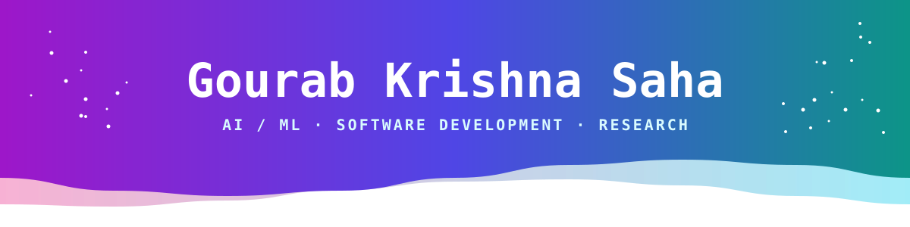</a>

### `> Hey There!, I am` [Gourab Krishna Saha](https://www.linkedin.com/in/gourab-krishna-saha/)

`「 CSE undergraduate at BRAC University building practical software across AI, ML, and the web 」`

 

  

<a href="https://portfolio-gks-10.vercel.app/">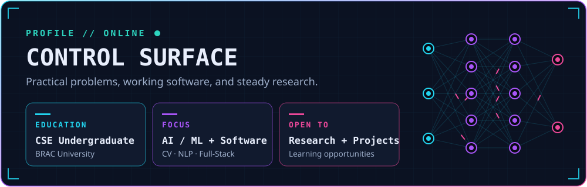</a>

 

**[Website](https://portfolio-gks-10.vercel.app/) &nbsp;|&nbsp; [Projects](PROJECTS.md) &nbsp;|&nbsp; [Collaboration](COLLABORATION.md)**

<a href="https://portfolio-gks-10.vercel.app/">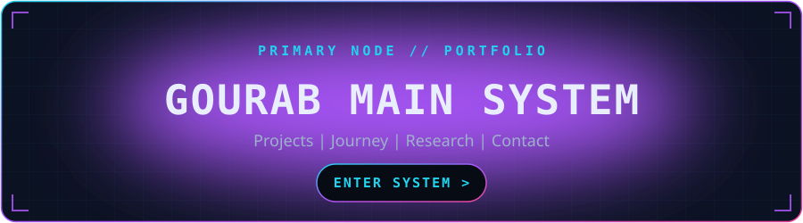</a>

  

<a href="https://researchflow-gks.vercel.app">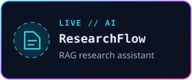</a>
<a href="https://gitworth-gks.vercel.app">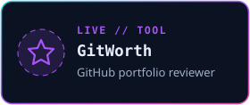</a>
<a href="https://spendora-gks.vercel.app">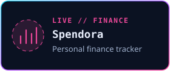</a>

 

 

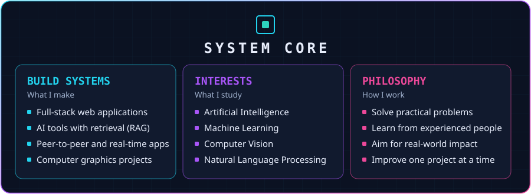

# 🛠 Technologies, Projects, and Domains

<table>
  <tr>
    <th>🛠 Technologies</th>
    <th>🧪 Projects</th>
    <th>🧠 AI Domains</th>
  </tr>
  <tr>
    <td valign="top">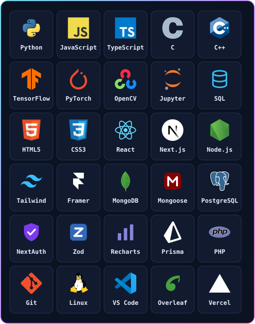</td>
    <td valign="top"><a href="PROJECTS.md"></a></td>
    <td valign="top"><a href="AI_DOMAINS.md"></a></td>
  </tr>
</table>

### 📊 Vital Statistics

  

  

  

<table>
  <tr>
    <th width="50%">🤝 Collaboration</th>
    <th width="50%">📫 Contact</th>
  </tr>
  <tr>
    <td valign="top">
      I'm open to collaborating on:
      <ul>
        <li>AI and machine learning projects</li>
        <li>Computer vision and NLP work</li>
        <li>Full-stack web applications</li>
        <li>Research opportunities</li>
      </ul>
      <a href="COLLABORATION.md"></a>
    </td>
    <td valign="top">
        
        
      
    </td>
  </tr>
</table>

⚡ *"Building, learning, and improving — one project at a time."*

**Star ⭐ the repos if they helped you!**

[Portfolio](https://portfolio-gks-10.vercel.app/) · [Projects](PROJECTS.md) · [AI Domains](AI_DOMAINS.md) · [Collaboration](COLLABORATION.md)

